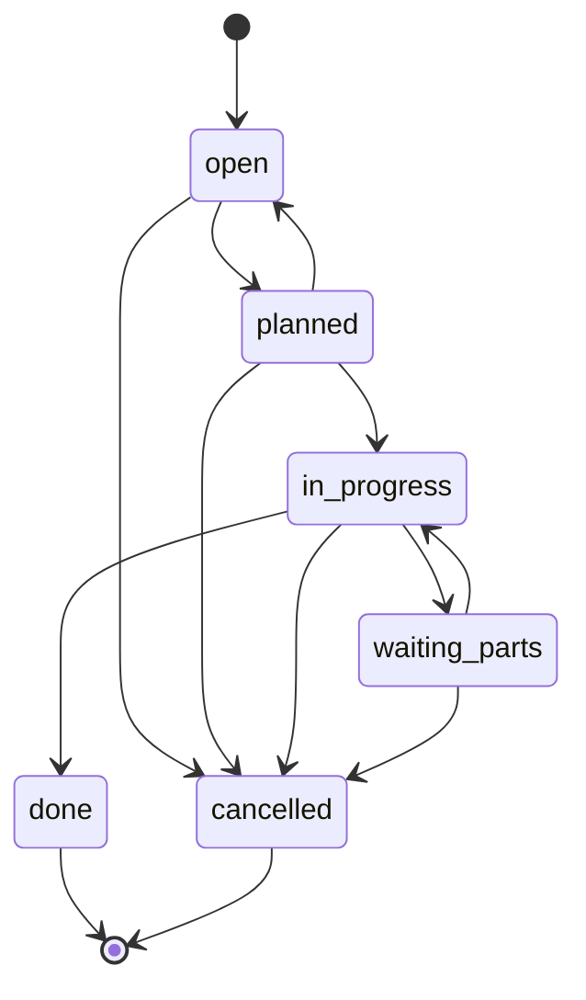

# Domäne

## Begriffe

| Begriff | Bedeutung | Im Code |
|---|---|---|
| Werk | Instandhaltungswerk mit eigener Disposition, z. B. Werk Nürnberg (`NUE`) | `Depot` |
| Fahrzeug | Triebzug oder Triebwagen mit Betriebsnummer, z. B. `442 017` | `Vehicle` |
| Baureihe | Fahrzeugtyp, z. B. ET 442 | `Vehicle.series` |
| Auftrag | Wartungs- oder Instandsetzungsauftrag für ein Fahrzeug, Nummer `WO-JJJJ-NNNNNN` | `WorkOrder` |
| Fristarbeit | Planmäßige Instandhaltung nach Laufleistung oder Zeit | `type: inspection` |
| Disposition | Plant Aufträge im eigenen Werk und weist sie zu | Rolle `dispatcher` |
| Technik | Führt Aufträge aus, meldet Status | Rolle `technician` |
| Controlling | Werksübergreifend lesend, Auswertungen | Rolle `viewer` |
| Ersatzteil | Verbautes Material mit Menge und Einzelpreis | `PartUsage` |
| Überfällig | Aktiver Auftrag, dessen Fälligkeit vor heute (Werkszeit) liegt | `isOverdue()` |

## Auftragstypen

Fristarbeit, Bremse, Radsatz, Störung, Schaden, Klima/Heizung. Die Anzeigetexte stehen in `src/domain/labels.ts`.

## Lebenszyklus eines Auftrags

| Status | Anzeige | Aktiv |
|---|---|---|
| `open` | Offen | ja |
| `planned` | Eingeplant | ja |
| `in_progress` | In Arbeit | ja |
| `waiting_parts` | Wartet auf Teile | ja |
| `done` | Abgeschlossen | nein, final |
| `cancelled` | Storniert | nein, final |

Regeln:

- Nach `in_progress` nur, wenn der Auftrag jemandem zugewiesen ist.
- Bei `done` wird `completedAt` gesetzt.
- Jeder Statuswechsel erzeugt einen Audit-Eintrag mit altem und neuem Status sowie optionalem Kommentar.

## Rollen und Rechte

| Rolle | Sichtbereich | Lesen | Anlegen | Status ändern | Zuweisen | Audit |
|---|---|---|---|---|---|---|
| Controlling (`viewer`) | alle Werke | ja | nein | nein | nein | nein |
| Technik (`technician`) | eigenes Werk | ja | nein | nur eigene Aufträge | nein | nein |
| Disposition (`dispatcher`) | eigenes Werk | ja | ja | ja | ja | nein |
| Administration (`admin`) | alle Werke | ja | ja | ja | ja | ja |

Die Prüfung passiert ausschließlich serverseitig in `src/auth/permissions.ts` und den Services. Die Oberfläche blendet Aktionen nur aus, sie ist keine Sicherheitsgrenze.
